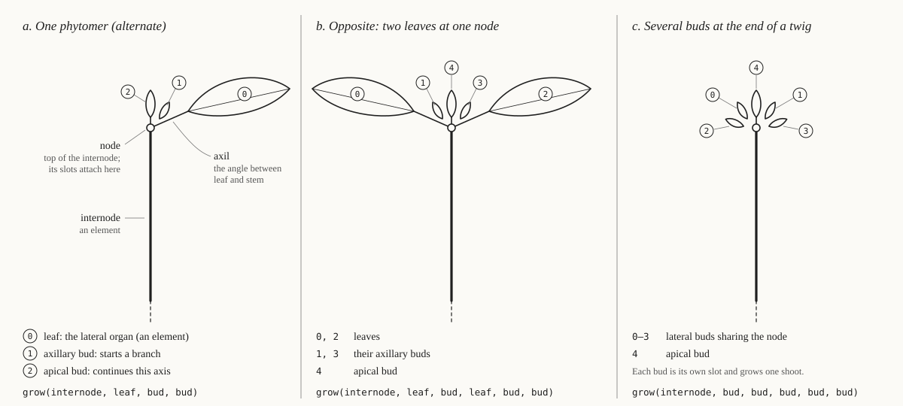
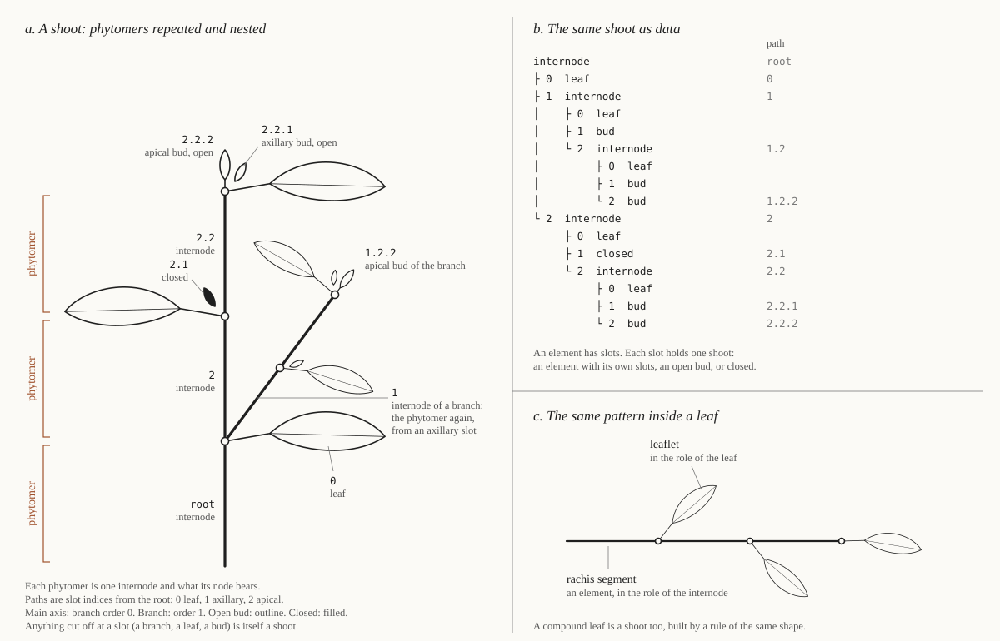
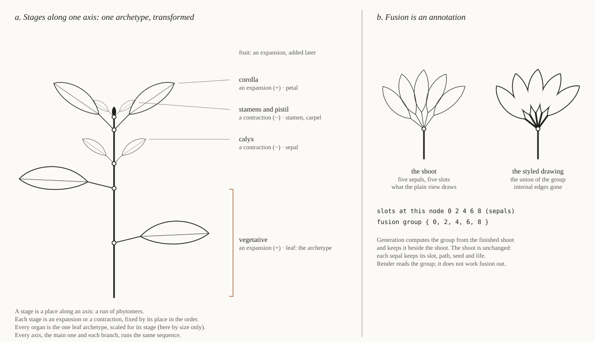

# Glossary

Terms as we use them in this project — not necessarily their full biological or technical breadth. Add a term the first time it's used in a sense that isn't obvious from plain English. Alphabetical.

## Format

```
**term** — definition, in our specific usage. (Distinguish from a related term if the two could be confused.)
```

A term new in an RFC that the user has not yet reviewed is marked *(proposed, RFC NNN)* and may change or be dropped; none is at present. *(RFC NNN)* names the RFC that explains an approved term.

Botanical words keep their botanical sense. A term that names a physical structure, or a part of one, appears in a diagram below, and its entry says which (principle 8). The diagrams are SVG files in [docs/diagrams/](docs/diagrams/), edited by hand; when a definition changes, its diagram changes in the same commit.

**Words to keep apart.** Three ideas sit close together: a **phase** is a stretch of time in one element's life; a **stage** is a place in Goethe's sequence along an axis; **expansion** and **contraction** are what a stage does. They do not collide yet. If a real case turns up where one of these words is needed in two senses, rework the three together then, not one at a time.

## Diagrams

**Phytomer.** One phytomer and its slots (a); two leaves at one node (b); several buds at one node (c).



**Shoot.** Phytomers repeated along an axis and nested in a branch, with slot paths (a); the same shoot as a tree of elements (b); the same pattern inside a compound leaf (c).



**Stages.** The stages along one axis, each an expansion or a contraction, with the one archetype transformed (a); fusion as an annotation beside five separate sepals (b).



## Terms

**anastomosis** — Goethe's term for parts growing together, e.g. sepals fusing into a calyx tube. Here it is drawn, not simulated, and never changes the tree: generation states which organs of a node fuse (a fusion group, an annotation), and the renderer draws the union of their outlines. *(RFC 003; diagram: stages b)*

**annotation** — a value computed from a finished shoot by a pure fold in generation and kept beside it, leaving the shoot unchanged. Fusion groups are the first. Render reads annotations and computes none. *(RFC 003; diagram: stages b)*

**apical** — at the end of an axis. The apical slot of an internode is the one that continues the same axis; an apical bud is that slot while it is still open. (Distinguish from **axillary**.) *(RFC 002; diagram: phytomer a)*

**archetype** — the leaf archetype: the plant's leaf, as a set of trait values (size, compoundness, vein structure, margin…), carried in the context through the stages. Every lateral organ is a transformation of it. *(RFC 003; diagram: stages a)*

**axil** — the angle between a leaf and the stem above it, at a node. Where axillary buds sit. *(RFC 002; diagram: phytomer a)*

**axillary** — in an axil. An axillary slot starts a new axis (a branch), one branch order higher than the axis it sits on; an axillary bud is that slot while it is still open. A node can have several. (Distinguish from **apical**.) *(RFC 002; diagram: phytomer a–c)*

**axis** — one line of phytomers, each grown from the apical slot of the one before: a stem, or a single branch. A new axis starts at an axillary slot. *(RFC 002; diagram: shoot a)*

**branch order** — how many axillary slots lie between an axis and the root: 0 for the main axis, 1 for its branches. Carried in the context. *(RFC 002; diagram: shoot a)*

**bud** — a slot that is still open: it holds no element yet and carries the context for whatever grows there. `then` replaces each bud with exactly one shoot. Apical or axillary by which slot it is. (Distinguish from **closed**.) *(RFC 002; diagram: phytomer a)*

**closed** — a slot that will grow nothing: a bud that never opens, or an axis that has ended. Closed is not drawn; a dormant bud that should be seen is an element with no open slots. It keeps its slot, so the slots beside it keep their paths. (Distinguish from **bud**, which can still grow.) *(RFC 002; diagram: shoot a)*

**compoundness** — how far an organ is divided into leaflets, as a depth: 0 simple, 1 once-pinnate, 2 twice. A trait of the archetype, separate from size: it divides the organ and does not enlarge it. *(RFC 003; diagram: shoot c)*

**concurrent** — element-level parallel composition: two changes to one element at the same time. Idempotent: a change concurrent with itself is one change. (Distinguish from **fork**.) *(RFC 002)*

**context** — what a rule is given to grow from, and what a bud carries: the path, position (branch order, index along the axis), stage and archetype (RFC 003), traits and mutations in force (RFC 004). It flows downwards only: an element's context goes to each of its slots, changed for that slot by the rule; nothing flows up or between siblings. *(RFC 002)*

**continue** — structure-level sequential composition, written `then(f, g)`: grow `f`, then replace each of its open buds with the shoot `g` grows from that bud's context. (Distinguish from **sequential**.) *(RFC 002)*

**contraction / expansion** — Goethe's alternation along the axis. Expansion: longer internodes, broader organs. Contraction: shorter internodes, narrower organs, organs drawn towards one node. Each is a property of a stage, and each word is used as a noun on its own ("the calyx is a contraction"), never as "expansion phase" or "contraction stage". *(RFC 003; diagram: stages a)*

**duration** — how long one plant takes to grow, in wall-clock seconds. An input to the plant (a per-plant trait, pinned by the jig to begin with), read only by the warp. (Distinguish from an element's primary duration, which is in growth units.) *(RFC 002)*

**element** — one drawn part with its own life: an internode, a leaf, a petal. It has ordered slots. *(RFC 002; diagram: phytomer a)*

**fork** — structure-level branching: an element having several slots, each growing its own shoot at the same time. Two leaves in two slots are two leaves. Not an operation on rules: a bud grows exactly one shoot. (Distinguish from **concurrent**.) *(RFC 002)*

**fusion group** — a set of slot paths naming the organs of one node that are drawn fused. An annotation; the organs remain separate elements. *(RFC 003; diagram: stages b)*

**internode** — the length of stem between two nodes. Here an element, whose slots all sit at its upper end, its node. *(RFC 002; diagram: phytomer a)*

**jig** — the dev-time control panel and what it drives: Tweakpane sliders for every form-affecting parameter, per-parameter locks, and the new-seed button (`src/ui/controls.ts`). Where exploration happens (principle 5).

**lateral organ** — what a node bears at its side: a leaf, or a leaf transformed (bract, sepal, petal, stamen, carpel; RFC 003). It occupies a lateral slot. *(RFC 002; diagram: phytomer a)*

**law** — an equation between meanings that holds for every value, e.g. `then` is associative. Derived from the meaning and checked by a property test; never assumed. *(RFC 001)*

**life** — everything one element does over time: its properties as functions of the time since it started, built from phases, with a primary duration after which growth continues from its slots. *(RFC 002)*

**lock** — a per-parameter toggle in the jig. A locked parameter keeps its value when a new seed is drawn; unlocked parameters are re-derived from the new seed. RFC 004 generalises this to pinning any trait.

**meaning** — the mathematical object a generation type stands for, chosen to be simpler than the code and independent of it. Two values are equal when their meanings are. Elliott's *denotation*. *(RFC 001)*

**meaning function** — the function from a representation to its meaning. Each operation is specified by requiring the meaning function to respect it (to be a homomorphism). *(RFC 001)*

**mutation** — a rare change to the traits a context carries (a function from traits to traits), applied at a slot and so scoped to the subtree grown from it; whether one occurs is drawn from its own weight table per seed or per slot. The first ones are named bud sports ('Pendula', 'Contorta', 'Fastigiata'). Not a synonym for phase or rule application. *(RFC 004)*

**near-semiring** — two monoids on one set with only one distributive law. What the structure level would be if a bud could grow several shoots; not used (RFC 002, J2). *(RFC 002)*

**node** — the botanical node: the upper end of an internode, where its lateral organs, axillary buds and apical slot attach. Several slots share one node (two leaves and their buds, for opposite arrangement). Not a separate thing in the tree, and not used for a tree-data-structure node, which is a slot or an element. (The one exception is `StructureNode` in today's code, which slice 1a replaces.) *(RFC 002; diagram: phytomer a–c)*

**organ** — here, the rule grown in a lateral slot: it reads the archetype, transformed for the stage and varied for the slot, and grows a simple leaf (one element) or a compound one (a shoot). *(RFC 003; diagram: stages a)*

**path** — a slot's position: the sequence of slot indices from the root. A slot's id, and with the root seed its seed, are functions of its path. *(RFC 002; diagram: shoot a, b)*

**phase** — time, within one element: one stretch of an element's life during which a set of property changes run together, e.g. an internode elongating while it greens. **Primary** phases must finish before growth continues from the element's slots; **secondary** phases (thickening, ageing, bending) run on alongside what grows next. *(RFC 002)*

**phytomer** — the unit of plant structure: one internode and what its node bears (lateral organs, axillary buds, the apical bud). Here it is a rule, not a kind of element; all structure is that rule repeated along an axis and nested in branches and compound organs (principle 9). (Distinguish from **shoot**: the phytomer is the pattern, a shoot is anything built in it.) *(RFC 002; diagram: phytomer a, shoot a)*

**pin** — fixing a trait to a value, so it isn't drawn from its weight table. A jig lock pins from the panel; input data (e.g. a species) pins from outside. *(RFC 004)*

**provenance** — what a generated element carries about how it was made: the rule that produced it, the parameters, and its seed (principle 2).

**RFC** — a design proposal in `rfcs/`: exploration and rationale, never canonical. Becomes a spec or a principle when accepted. (Distinguish from **spec**.)

**rule** — a function from a context to a shoot whose open buds carry the contexts for what grows next. Rules are composed with `then` and `grow`. *(RFC 002; today's code uses the word for the name recorded in provenance)*

**sample** — to evaluate a growing plant at one time `t`, giving the drawing for that instant. Pure: the same seed, traits and `t` give the same drawing. *(RFC 002)*

**seed lineage** — the chain of seeds from the root seed to a slot, each derived from its parent's by `deriveSeed`. Gives every slot a stable seed of its own without a shared RNG.

**sequential** — element-level sequential composition: one phase after another within one element. (Distinguish from **continue**.) *(RFC 002)*

**settle time** — the latest moment at which anything in a growing plant is still changing. The image is the plant sampled at its settle time. *(RFC 002)*

**shoot** — the tree a rule grows, at any size: a single bud, a leaf, a branch, the whole plant. Anything cut off at a slot is a shoot, and a plant is one shoot. Wider than the botanical word (a stem with its leaves): here a leaf is a shoot too. (Distinguish from **phytomer**.) *(RFC 002; diagram: shoot a–c)*

**size** — of an organ: the length and width of the whole organ, simple or compound. A trait of the archetype. Leaflets are fitted inside it. *(RFC 003)*

**slot** — one position among an element's children. Slots are ordered and indexed, each holds exactly one shoot (an element, a bud, or closed), and an internode's slots all sit at its node. Ids and seeds belong to slots. *(RFC 002; diagram: phytomer a–c)*

**spec** — an approved decision in `specs/` that the code must match. Canonical. (Distinguish from **RFC**.)

**stage** — place, along one axis: one step of Goethe's fixed sequence: vegetative leaves, calyx, corolla, stamens and pistil, fruit. Each stage is a run of phytomers whose organ is the archetype transformed for that stage. *(RFC 003; diagram: stages a)*

**structure node** — today's code only, replaced by slice 1a: one entry of the tree generation produces (`StructureNode`): geometry, provenance, children, and a stable id of the form `rule:path`. What render consumes and what the inspector and feedback attach to.

**trait** — a named, typed morphological variable (arrangement, divergence angle, leaf compoundness, a growth-rate curve…), either pinned or drawn from a weight table, per seed or per slot. *(RFC 004)*

**variation** — how much organs of one stage may differ in size from slot to slot: a trait `v ≥ 0` bounding a per-slot factor. *(RFC 003)*

**warp** — a monotone function applied to time before sampling. Normalising growth time to `[0, 1]` and stretching that over the plant's duration are warps; they are presentation, outside the algebra. *(RFC 002)*

**weight table** — a distribution over a trait's values; rarity is the shape of the table. Can be authored, or built from data (e.g. species counts near a location). *(RFC 004)*
