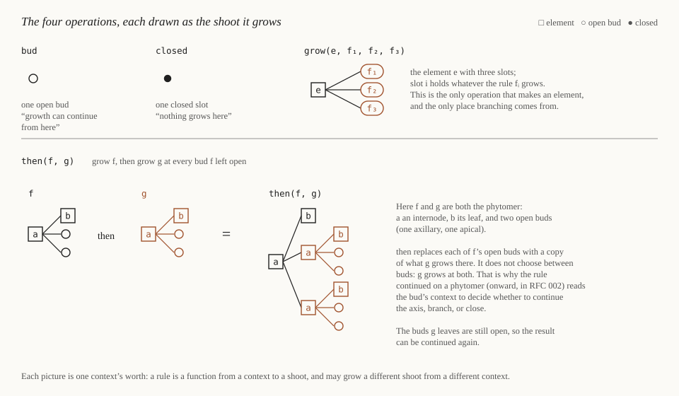
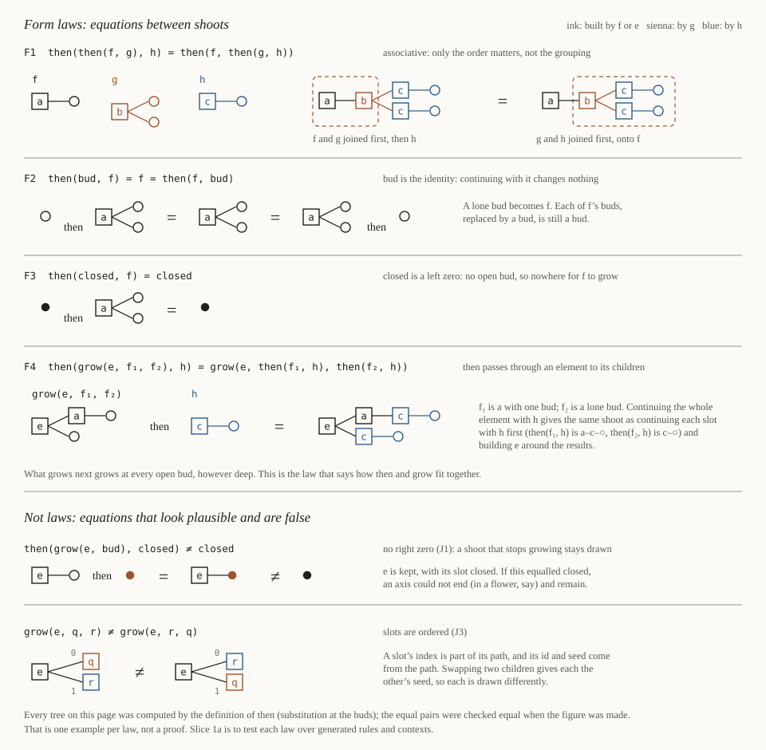

# The growth algebra, drawn

A reading aid for [RFC 002](../rfcs/rfc_002_growth_algebra.md), §Meaning and laws. It adds nothing to the RFC and is not canonical: where the two disagree, the RFC is right and this file is stale. When the laws become spec text (with slice 1a), these figures are redrawn there and this file goes.

It assumes no mathematics beyond arithmetic. The maths words are collected in [one table](#the-maths-words) at the end; every other section tries to do without them.

## What "algebra" means here

An algebra is three things: some kind of thing, a few ways of combining those things, and equations that hold whatever you put in.

Whole numbers are the familiar one. The things are numbers, the ways of combining are `+` and `×`, and the equations are facts like `(a + b) + c = a + (b + c)`. Nobody checks that equation number by number. It is a property of `+`, and knowing it is what lets you add a column of figures in any grouping you like.

This project has two algebras:

| | The things | Ways of combining |
|---|---|---|
| **Form** | rules, each growing a shoot | `then`, `grow` (with `bud` and `closed` as the two simplest rules) |
| **Lives** | timed changes to one element | sequential `·`, concurrent `+` (with `instant` as the simplest life) |

The reason to care is that each equation is a promise about how the work behaves, and each becomes a test. "The scrubber shows the same frame for the same time" and "moving a control leaves the rest of the plant where it was" are statements of this kind. Equally useful are the equations that look right and are false: they mark what the model has decided not to do, and each has a test too, so that it isn't "fixed" by accident.

The nouns used below (shoot, element, slot, bud, rule, life, phase) are drawn in the [glossary](../GLOSSARY.md#diagrams), model set.

## Form: the four operations

A rule is a function from a context to a shoot. Four operations build every rule. The figure draws each as the shoot it grows.

Two things to take from it:

- `grow` is the only operation that makes an element, and the only source of branching: an element has as many slots as `grow` was given rules.
- `then` is substitution. It finds every open bud and puts a shoot there. It never picks one bud over another. Choosing (continue the axis here, branch there, stop here) is done by the rule being continued, which reads the context the bud carries.

## Form: the laws

Each row is an equation. Both sides were computed from the definition of `then`, so where the figure says two shoots are equal, they are the same tree.

What each one is for:

| Law | In plain words | What it gives the work |
|---|---|---|
| F1 | Continuing in three steps gives the same plant however the steps are grouped. | An axis can be written as a chain of stages without saying which pair is joined first. A stem with its flower is the same rule whether the flower was attached to the stem or the stem was put under the flower. |
| F2 | Continuing with `bud` does nothing. | A stage that grows nothing is expressible: it is a rule that hands on a bud. There is a "do nothing" to build from. |
| F3 | Nothing grows from `closed`. | Closing a bud is final. No later rule can reopen it. |
| F4 | What grows next grows at every open bud, at any depth. | A rule doesn't need to know how deep its predecessor's buds are. Also the reason a rule must close every bud it doesn't want continued. |
| no right zero | Ending growth doesn't erase what grew. | An axis can end (in a flower) and stay drawn. Decided as J1. |
| slots ordered | Swapping two children changes the plant. | Each slot keeps its own id and seed, so toggling one bud doesn't reshuffle its neighbours. Decided as J3. |

The identity laws (I1 to I3: a slot's id and seed depend only on its path, and a change under one slot leaves every other slot alone) are not equations between shoots, so they have no row here. What they are about is visible in the glossary's model set, tree diagram: every slot has a path, and nothing done under path `1` can change the path of anything under `2`.

## Lives: two ways to combine changes

A life is what one element does over time. Its building block is one timed change to one property (length goes from 0 to full over 3 units). There are two ways to combine lives, drawn here as bars on a time axis, one lane per property.

| Law | In plain words | What it gives the work |
|---|---|---|
| E1 | A sequence of phases is the same however it is grouped. | Phases can be listed in order with no brackets. |
| E2 | Concurrent changes can be listed in any order and any grouping, and saying one twice is saying it once. | "Elongate while greening" and "green while elongating" are one life. |
| E3 | A sequence lasts the sum of its parts; concurrent lives last as long as the longest. | The duration of any life can be read off its parts without running it. This is what start times are computed from. |
| E4 | "a, then b and c together" is the same as "a then b, together with a then c". | The two ways of writing a shared lead-in agree. |
| no right distributivity | "a and b together, then c" is not "a then c, together with b then c". | When a and b differ in length, the left side has one c that waits for both; the right would have two, starting at different times. The two expressions mean different things and are not interchangeable. |
| no zero | No life cancels whatever it is joined to. | Nothing is un-grown. A shoot that dies is a bud that is closed (J4). |

## From lives to growth

The two algebras meet in one rule: an element starts when its parent's primary phase ends. That is drawn in the glossary's model set, life diagram, panel b, which is also the picture for the time laws:

- **T1, T2.** Every start time is the sum of the primary durations on the way to that element. Continuing a plant further never moves the start of anything already there.
- **T3, T5.** After the settle time nothing changes, and what is drawn then is exactly the finished tree. The image is that frame.
- **T4.** A sample depends only on the seed, the context and the time asked for. Scrubbing backwards and forwards gives the same frame for the same time.
- **T6.** The plant's duration in seconds stretches the time axis and changes nothing else.

## Where counting comes in

VISION.md starts from the idea of a semiring (see the table below). Neither algebra above is one. A semiring does appear when the tree is *measured*: when a question's answer adds across siblings and multiplies along `then`.

**Counting open buds.** In the operations figure the phytomer leaves 2 open buds. `then(phytomer, phytomer)` leaves 2 × 2 = 4: count the open circles in the result. `grow` adds its children's counts; `then` multiplies (for rules whose count doesn't depend on the context). That is ordinary `+` and `×`.

**Timing.** The time a bud opens is the *sum* of primary durations along its path. The settle time is the *maximum* over all paths. Here "max" plays the part of `+` and "+" plays the part of `×`. The path that attains the maximum is what holds the plant's growth up: its critical path.

Both are candidates for inspector readouts (generative-morphology-4uz) and are unverified until the slice has tests for them.

## The maths words

Each is a name for a pattern of equations. The arithmetic column is the pattern in numbers.

| Word | Plain meaning | In arithmetic | Here |
|---|---|---|---|
| **associative** | Grouping doesn't matter; order still might. | `(2 + 3) + 4 = 2 + (3 + 4)` | `then` (F1), sequential (E1), concurrent (E2) |
| **commutative** | Order doesn't matter. | `2 + 3 = 3 + 2`; but `5 − 2 ≠ 2 − 5` | concurrent (E2). Not `then`, not sequential, not the children of `grow`. |
| **identity** | The "do nothing" value for an operation. | `0` for `+`, `1` for `×` | `bud` for `then` (F2); `instant` for both life operations |
| **zero** | The value that swallows whatever it is combined with. | `0` for `×`: `0 × a = 0` | `closed` on the left of `then` only (F3). Lives have none. |
| **idempotent** | Doing it twice is doing it once. | `max(a, a) = a`; but `a + a ≠ a` | concurrent (E2) |
| **distributive** | One operation can be pushed inside another. | `2 × (3 + 4) = 2×3 + 2×4` | sequential over concurrent, from the left only (E4) |
| **monoid** | A set with one associative operation and an identity. Lists under joining are the standard example. | numbers with `+` and `0` | rules with `then` and `bud`; lives with `·` and `instant`; lives with `+` and `instant` |
| **semiring** | Two monoids on the same things, where one distributes over the other from both sides and the "add" identity is a zero for "multiply". | numbers with `+` and `×` | Only the measurements above. The form level has one operation on rules, not two (no fork, J2), and no right zero (J1); the life level fails on right distributivity. |
| **near-semiring** | A semiring missing one distributive law. | | What form would be if a bud could grow several shoots. Not used (J2). |
| **homomorphism** | A measurement that respects the operations: measure the parts and combine the answers, or combine the parts and measure, and get the same thing. | the length of two lists joined is the sum of their lengths | duration (E3); the bud count; the meaning function itself (RFC 001) |
| **monad**, **Kleisli composition** | The name for "a container with holes, and substitution into the holes" and for composing functions that produce such containers. | | `Shoot` with its buds as the holes, and `then`. A statement about which laws hold (F1, F2), not machinery in the code. |
